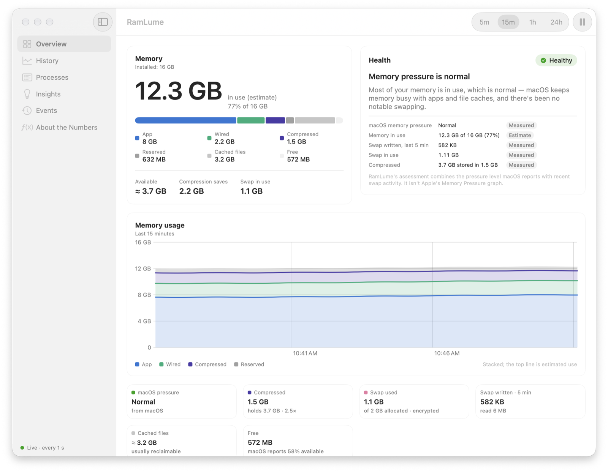
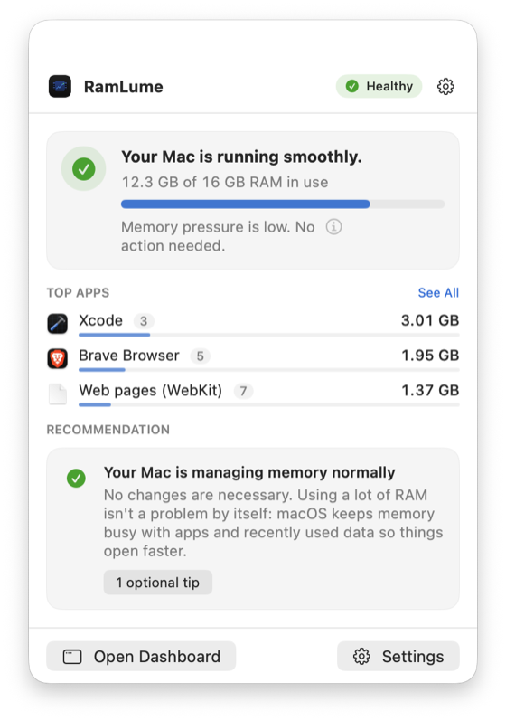
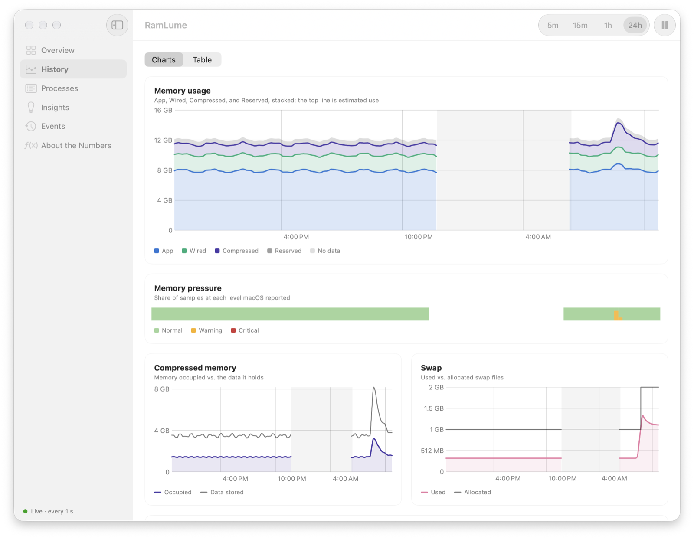
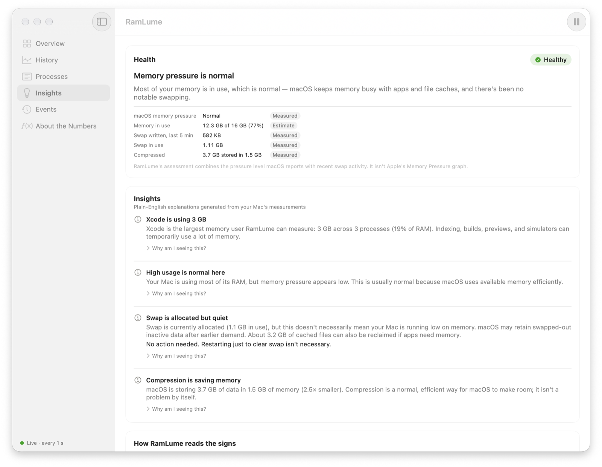
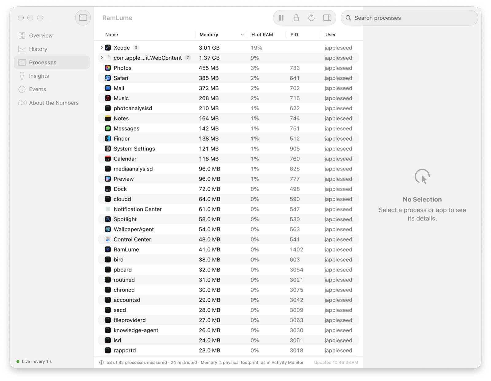

# RamLume

**Understand your Mac's memory.**

RamLume is a free, open-source menu bar app for macOS that shows how your Mac is using its
memory and explains what the numbers mean in plain English. It reads statistics straight from the
macOS kernel, never guesses, and runs entirely on your Mac.

[](https://github.com/13nik09/ramlume/actions/workflows/ci.yml)

> **Status: 0.1.0, the first public version.** Release builds are universal (Apple silicon and
> Intel) and **not notarized** unless a release says otherwise, so macOS asks you to confirm the
> first launch. See [Installation](#installation).

<picture>
  <source media="(prefers-color-scheme: dark)" srcset="docs/images/overview-dark.png">
  
</picture>

<sub>Screenshots show example data.</sub>

## Why RamLume

macOS uses memory aggressively on purpose, so "12 GB of 16 GB used" usually means nothing is
wrong. RamLume puts the kernel's own **memory pressure** level front and center, watches **swap
activity** rather than swap size, and tells you — calmly — when something actually deserves
attention. It never sells you a "RAM cleaner".

## Features

- **Menu bar monitoring**: a memory-chip icon with an optional percentage or used/total, tinted
  only when memory genuinely needs attention (never because of a percentage).
- **A simple panel**: your Mac's status in one sentence ("Your Mac is running smoothly."), memory
  in use with a single bar, the three apps using the most memory, and one recommendation.
- **Three questions, answered first**: the dashboard opens on Home (is my Mac healthy, which apps
  use my RAM, what should I do?), with Applications and Recommendations one click away.
- **Recommendations**: offline, rule-based tips with the reason, the suggested action, and
  step-by-step instructions, for example turning on Memory Saver in Brave or Chrome, reviewing
  login items, or quitting apps while memory pressure is high. When nothing needs doing, RamLume
  says so; it never suggests restarting to clear swap and never "cleans" memory or quits apps.
- **Health status**: Healthy, Elevated, High Pressure, or Checking, based on the kernel's pressure
  level and measured swap activity. High usage alone never counts against you.
- **Applications**: physical footprint per app (the same metric as Activity Monitor), grouped
  with its helper processes (a browser's renderer and GPU helpers appear under the browser),
  with search, sorting, details, and honest "Restricted" labels for processes macOS doesn't let
  it read.
- **Advanced Details**: the full memory breakdown (App, Wired, Compressed, Reserved, Cached,
  Free), every insight with its evidence, history charts (memory, compression, swap, swap
  activity, pressure) over 5 minutes to 7 days with gaps shown as gaps and a table view, the
  event timeline, and plain-English definitions next to the exact formulas. Every value is
  labelled as measured, derived, or estimated, and the categories add up to installed memory.
- **Notifications (opt-in)** for critical or sustained pressure, rapid swap growth, and steady
  app memory growth, with cooldowns. Off by default.
- **Light on resources**: about 0.1 % of one CPU core and a 17 MB memory footprint while it sits
  in the menu bar (measured; see [docs/performance.md](docs/performance.md)).
- **Private**: no network access, analytics, accounts, or elevated privileges
  ([docs/privacy.md](docs/privacy.md)).
- Launch at login, three monitoring modes (Responsive, Balanced, Energy Saver), Low Power Mode
  awareness, light/dark/system appearance, VoiceOver labels, and Reduce Motion support.

## Screenshots

<!-- These show the dashboard before the simplified navigation (Home, Applications,
Recommendations, Advanced Details); they need retaking. -->

| Menu bar panel | History |
|---|---|
| <picture><source media="(prefers-color-scheme: dark)" srcset="docs/images/panel-dark.png"></picture> | <picture><source media="(prefers-color-scheme: dark)" srcset="docs/images/history-dark.png"></picture> |

<picture>
  <source media="(prefers-color-scheme: dark)" srcset="docs/images/insights-dark.png">
  
</picture>

<picture>
  <source media="(prefers-color-scheme: dark)" srcset="docs/images/processes-dark.png">
  
</picture>

## Requirements

- macOS 14 Sonoma or later, on Apple silicon or Intel (universal binary).
- To build from source: Xcode 26 or later. No third-party dependencies.

## Installation

1. Download `RamLume-<version>-macOS.zip` from the
   [Releases page](https://github.com/13nik09/ramlume/releases).
2. Optionally, check the download against the SHA-256 checksum in the release notes:
   ```bash
   shasum -a 256 ~/Downloads/RamLume-0.1.0-macOS.zip
   ```
3. Double-click the zip, then drag **RamLume** into your **Applications** folder. (Launch at
   login works reliably only from there.)
4. Open RamLume. Its icon appears in the menu bar, and a short welcome note opens below it.

**First launch of a build that isn't notarized.** macOS can't check such an app for malicious
software and stops it the first time:

- **macOS 15 Sequoia and later:** open RamLume once and dismiss the warning. Then open
  **System Settings › Privacy & Security**, scroll down to the message about RamLume, click
  **Open Anyway**, and confirm.
- **macOS 14 Sonoma:** Control-click RamLume in Applications, choose **Open**, then **Open** again.

You only need to do this once per downloaded version. If a release is notarized, its notes say so
and none of this is needed.

### Uninstalling

Turn off **Open RamLume at login** in Settings if you enabled it, quit RamLume, and move it from
Applications to the Trash. To remove its data as well, delete
`~/Library/Application Support/RamLume` (memory history) and its preferences:

```bash
defaults delete io.github.13nik09.RamLume
```

## Building from source

1. Clone this repository.
2. Open `RamLume.xcodeproj` in Xcode.
3. Select the **RamLume** scheme and **My Mac**, then press ⌘R.

To build the release archive from the command line (universal, ad-hoc signed):

```bash
scripts/make-release.sh
```

The archive and its checksum end up in `dist/`. [docs/building.md](docs/building.md) covers
signing with a Developer ID, notarization, and using your own bundle identifier.

## How the numbers work

| Figure | Source | Kind |
|---|---|---|
| Wired, Compressed | `host_statistics64` page counts | Measured |
| App | anonymous − purgeable pages | Derived |
| Cached files | file-backed + purgeable pages | Estimate (reclaimable) |
| Free | free − speculative pages | Derived |
| Reserved | `hw.memsize − hw.memsize_usable` | Derived |
| Used | everything except Cached files and Free | Estimate |
| Swap | `vm.swapusage` | Measured |
| Memory pressure | `kern.memorystatus_vm_pressure_level` + dispatch pressure events | Measured (macOS's own level) |
| Health | RamLume's rules | Heuristic |
| Process memory | `proc_pid_rusage` physical footprint | Measured |

Read the details, including a side-by-side comparison with Activity Monitor and `vm_stat`, in
[docs/memory-metrics.md](docs/memory-metrics.md). Run
`/Applications/RamLume.app/Contents/MacOS/RamLume --dump-metrics` to see every raw value behind
the numbers.

## Documentation

- [How RamLume measures memory](docs/memory-metrics.md)
- [Health, insights, and notifications](docs/diagnostics.md)
- [Architecture](docs/architecture.md)
- [Performance](docs/performance.md)
- [Privacy](docs/privacy.md)
- [Building, signing, and releasing](docs/building.md)
- [Roadmap](docs/roadmap.md)
- [Contributing](CONTRIBUTING.md)
- [Changelog](CHANGELOG.md) and [0.1.0 release notes](docs/release-notes/v0.1.0.md)

## Contributing

Bug reports, measurements from different Macs, and pull requests are welcome. Please read
[CONTRIBUTING.md](CONTRIBUTING.md) first; it explains the project's accuracy principles.
To report a bug, use [GitHub Issues](https://github.com/13nik09/ramlume/issues) (also in
RamLume's **Help** menu).

## License

RamLume is free software, released under the [GNU General Public License v3.0](LICENSE). You can use,
study, share, and change it; if you distribute a modified version, it must be under the same license,
with its source code available.
