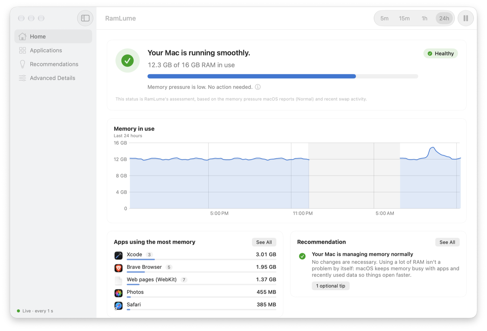

# RamLume 0.1.0

The first public version of RamLume, a free, open-source menu bar app that shows how your Mac is
using its memory and explains what the numbers mean in plain English.

<picture>
  <source media="(prefers-color-scheme: dark)" srcset="https://raw.githubusercontent.com/13nik09/ramlume/v0.1.0/docs/images/home-dark.png">
  
</picture>

## Highlights

- **Your Mac's status in one sentence**, such as "Your Mac is running smoothly.", in the menu bar
  panel and on Home. It follows the memory pressure level macOS reports and measured swap
  activity, never a usage percentage alone.
- **The numbers behind it**: the figures Activity Monitor shows (physical memory, memory in use,
  app, wired, and compressed memory, cached files, swap used) on Home, and in Advanced Details a
  breakdown that adds up exactly to installed memory, with the evidence behind every conclusion.
- **Which apps use your memory**, each grouped with its helper processes and measured with the
  same physical-footprint metric as Activity Monitor, with honest "Restricted" labels where macOS
  doesn't let an app read a process.
- **Recommendations** in plain English, with the reason and step-by-step instructions, for
  example turning on Memory Saver in Brave or Chrome. RamLume never "cleans" memory, quits apps,
  or changes settings for you.
- **History** for up to 7 days, with sleep, pauses, and time RamLume wasn't running shown as
  gaps rather than filled in.
- **Opt-in notifications** for critical or sustained memory pressure, rapid swap growth, and
  steady app memory growth, with cooldowns.
- **Light and private**: about 0.1 % of one CPU core and 17 MB of memory while it sits in the
  menu bar ([measured](https://github.com/13nik09/ramlume/blob/main/docs/performance.md)). No
  network access, analytics, accounts, or administrator privileges.

## Requirements

macOS 14 Sonoma or later, on Apple silicon or Intel.

## Download

**RamLume-0.1.0-macOS.zip** (universal)

SHA-256: `d15b8bf4a6cce3347f0f52bbd9ae130e3160e7056562171cfc1d58fb60a47e71`

<!-- This checksum belongs to the ad-hoc signed archive built on 2026-10-30 from the same code as
the commit that adds it. Any rebuild, for example with a Developer ID, produces a different
archive: paste the new value from dist/*.sha256. -->

## Before you open it

<!-- Keep this section for an ad-hoc signed build. For a build that make-release.sh reported as
"Developer ID signed and notarized", replace it with:
"This build is signed with a Developer ID and notarized by Apple." -->

This build is **not notarized** by Apple, so macOS stops the first launch:

1. Unzip the download and move **RamLume** to your **Applications** folder.
2. Open RamLume and dismiss the warning.
3. **macOS 15 or later:** open System Settings › Privacy & Security, scroll to the message about
   RamLume, click **Open Anyway**, and confirm.
   **macOS 14:** Control-click RamLume in Applications, choose **Open**, then **Open** again.

You only need to do this once.

## Good to know

- RamLume asks for no permissions at startup. Notifications are off until you turn them on, and
  "Open RamLume at login" is off until you enable it in Settings.
- Memory for processes owned by other users (system services, root) is shown as Restricted:
  macOS doesn't let unprivileged apps read it, and RamLume never substitutes another number.
- Activity Monitor's Memory Used and Cached Files use Apple's own unpublished calculations, so
  RamLume's estimates can differ slightly. The exact formulas are in
  [How RamLume measures memory](https://github.com/13nik09/ramlume/blob/main/docs/memory-metrics.md).
- The universal binary has been built for Intel but tested only on Apple silicon so far. Reports
  from Intel Macs are very welcome.

Found a problem? [Open an issue](https://github.com/13nik09/ramlume/issues/new/choose) and include
the output of `/Applications/RamLume.app/Contents/MacOS/RamLume --dump-metrics`.
