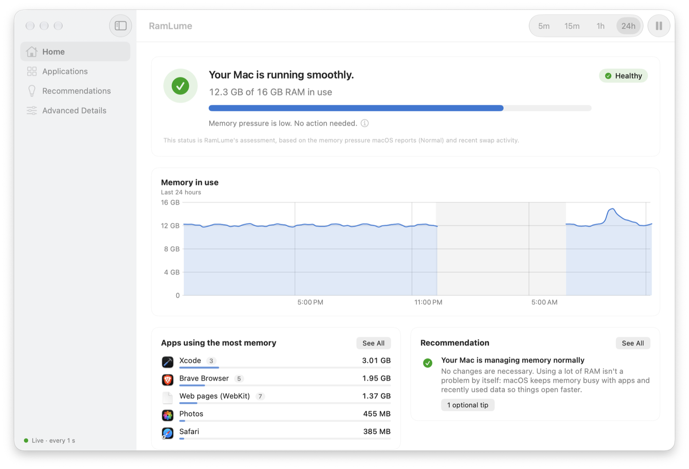

# RamLume 0.1.1

A small update to RamLume 0.1.0: Home fits the window again, RamLume uses less CPU while its
windows are open, and a few bugs are fixed.

<picture>
  <source media="(prefers-color-scheme: dark)" srcset="https://raw.githubusercontent.com/13nik09/ramlume/v0.1.1/docs/images/home-dark.png">
  
</picture>

## What's new

- **Home fits the window again.** The status, the memory chart, the largest apps, and the
  recommendation are all in view; the memory details moved below them.
- **Less CPU while RamLume's windows are open:** about a third less on Home, a little less in
  the menu bar panel. If the panel or the dashboard is left open while the displays sleep,
  RamLume now drops to its slow idle sampling.
- **Fewer disk writes:** history is saved every 15 minutes instead of every 5, and as before
  whenever the Mac sleeps or RamLume quits.

## Fixes

- Chart time labels are centered under their grid lines, and the last one no longer sticks out
  past the chart. On macOS 27 they used to start at the line.
- Pausing or resuming monitoring updates the panel's menu and its "Monitoring is paused" note
  right away.
- Setting the Mac's clock back no longer stops the app list and history saves from updating.

## Requirements

macOS 14 Sonoma or later, on Apple silicon or Intel.

## Download

**RamLume-0.1.1-macOS.zip** (universal)

SHA-256: `6abd5b81b5d94c4dcd5df24cf3c228344bd6f17c3945eb2f5024de860a8ad23a`

<!-- This checksum belongs to the ad-hoc signed archive built on 2026-10-30 from the same code as
the commit that adds it. Any rebuild, for example with a Developer ID, produces a different
archive: paste the new value from dist/*.sha256. -->

## Updating from 0.1.0

Quit RamLume, replace the copy in your **Applications** folder with the new one, and open it.
Your history and settings carry over.

## Before you open it

<!-- Keep this section for an ad-hoc signed build. For a build that make-release.sh reported as
"Developer ID signed and notarized", replace it with:
"This build is signed with a Developer ID and notarized by Apple." -->

This build is **not notarized** by Apple, so macOS stops the first launch of each new version:

1. Unzip the download and move **RamLume** to your **Applications** folder.
2. Open RamLume and dismiss the warning.
3. **macOS 15 or later:** open System Settings › Privacy & Security, scroll to the message about
   RamLume, click **Open Anyway**, and confirm.
   **macOS 14:** Control-click RamLume in Applications, choose **Open**, then **Open** again.

Found a problem? [Open an issue](https://github.com/13nik09/ramlume/issues/new/choose) and include
the output of `/Applications/RamLume.app/Contents/MacOS/RamLume --dump-metrics`.
